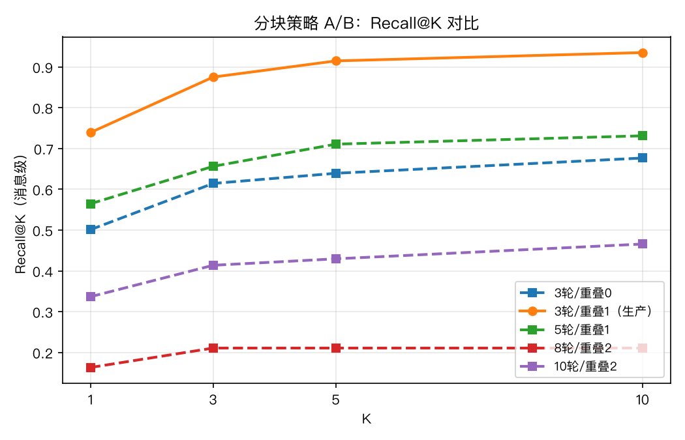
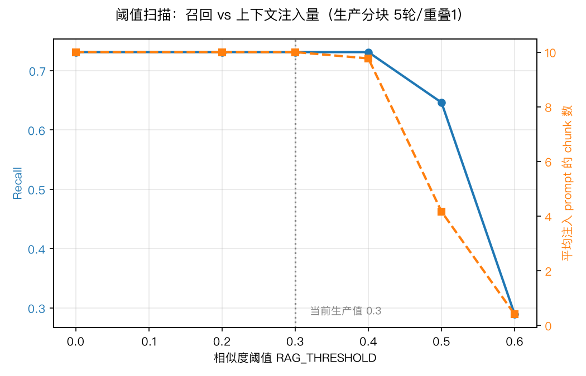
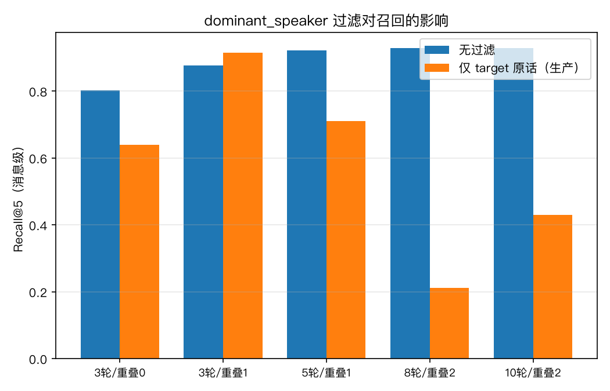
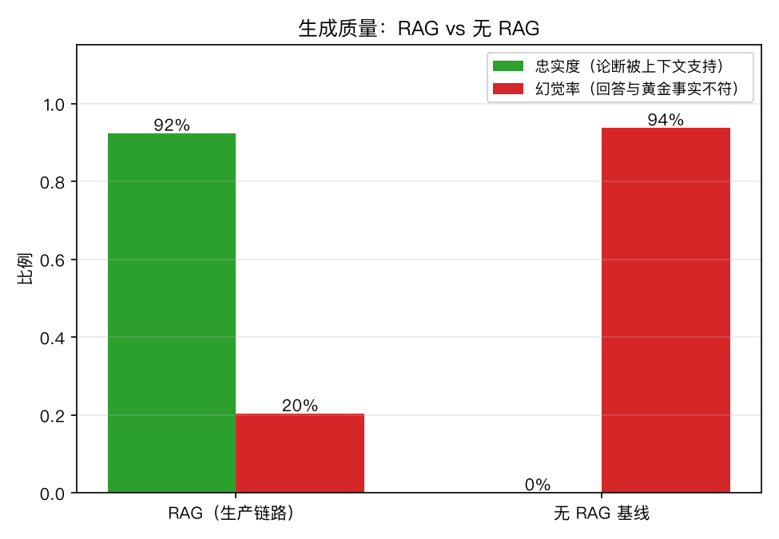
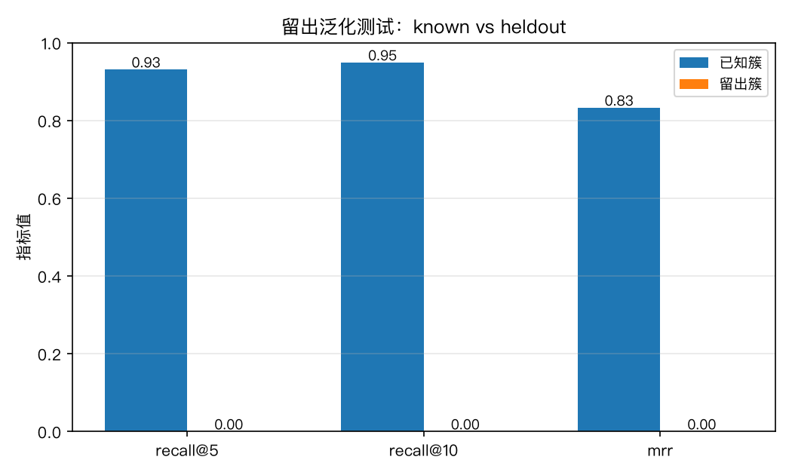
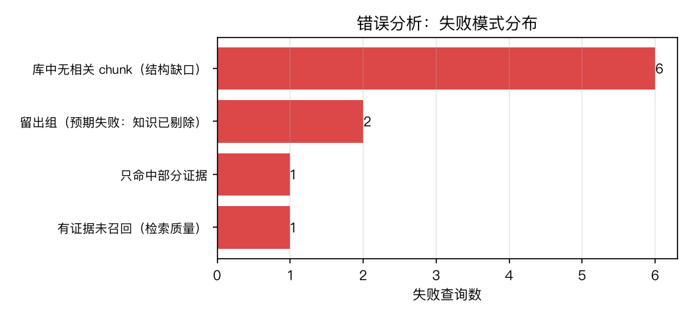

# RAG 评测报告

> 生成日期：2026-10-25　|　语料：316 条消息　|　Golden Dataset：147 条查询　|　Embedding：BAAI/bge-m3

评测方法：合成微信风格语料 + 消息级 ground truth（chunk ID 随分块参数变化，
消息级标注才能横向对比分块策略）。指标全部手写实现，见 `evals/metrics.py`。
复现：`python -m evals.run_eval all`

## 1. 分块策略 A/B（生产检索路径）

| 配置 | chunks | Recall@5 | Recall@10 | MRR | nDCG@10 | Precision@5 |
|---|---|---|---|---|---|---|
| 3轮/重叠0 | 106 | 63.9% | 67.7% | 0.622 | 0.653 | 14.6% |
| 3轮/重叠1（生产） | 158 | 91.5% | 93.5% | 0.826 | 0.821 | 22.0% |
| 5轮/重叠1 | 79 | 71.1% | 73.1% | 0.655 | 0.638 | 23.5% |
| 8轮/重叠2 | 53 | 21.1% | 21.1% | 0.190 | 0.199 | 4.9% |
| 10轮/重叠2 | 40 | 43.0% | 46.6% | 0.394 | 0.410 | 12.1% |

最优配置：**3轮/重叠1**（Recall@5 91.5%，生产配置为 91.5%）。

## 2. 相似度阈值扫描（RAG_THRESHOLD）

| 阈值 | Recall | 平均注入条数 | 注入命中率 |
|---|---|---|---|
| 0.0 | 93.5% | 10.0 | 11.8% |
| 0.2 | 93.5% | 10.0 | 11.8% |
| 0.3 | 93.5% | 10.0 | 11.8% |
| 0.4 | 93.5% | 9.9 | 12.5% |
| 0.5 | 85.7% | 4.7 | 39.4% |
| 0.6 | 49.0% | 0.6 | 47.8% |

## 3. dominant_speaker 过滤的代价

生产路径只检索 `dominant_speaker == target` 的 chunk。
对比无过滤检索，量化该过滤对召回的影响：

## 4. 生成质量：忠实度与幻觉率

抽样 60 条查询（每个事实簇最多一条），生成模型 deepseek-chat（生产采样参数），judge 模型 deepseek-chat（temperature=0，论断级判定）。

| 模式 | 忠实度 | 幻觉率 | 论断准确率 | 计分回答数 |
|---|---|---|---|---|
| RAG（生产链路） | 92.4% | 20.3% | 89.7% | 59 |
| 无 RAG 基线 | — | 93.8% | 8.8% | 48 |

- 忠实度 = 回答中被检索上下文支持的论断占比（无 RAG 基线没有上下文，不适用）
- 幻觉率 = 含「与黄金事实矛盾/凭空编造细节」论断的回答占比（严格口径）
- judge 解析失败剔除 0 条，不参与计分

## 5. 留出泛化测试（独立开发集）

把 3 个事实簇的 target 消息（6 条）从检索库剔除，其余事实簇照常建库。同查询集分两组对比：

| 分组 | 查询数 | Recall@5 | Recall@10 | MRR | nDCG@10 |
|---|---|---|---|---|---|
| 已知簇 | 138 | 93.1% | 94.9% | 0.833 | 0.601 |
| 留出簇 | 9 | 0.0% | 0.0% | 0.000 | 0.000 |

留出簇 recall@10=0.0%，远低于已知簇 (94.9%，gap 94.9%)：被剔除的证据未被误召回，留出切分生效。这是「切分无泄漏」的流程有效性检查——留出组的 gold 消息本就不在库中，recall=0 属构造性必然，既不说明检索质量，也不代表模型能正确拒答。

**已知簇与主评测的口径关系：** 两者现均运行在生产配置 `turns3_overlap1`（由 `config.py` 的 `CHUNK_TURNS`/`CHUNK_OVERLAP` 决定）。此前 `per_query_prod` 停留在旧配置 (5,1)，与留出测试 (3,1) 口径不一致，造成两组数字看似悬殊；统一配置后该差异已消失。剔除 6 条消息后检索库重新分块，chunk 的 `dominant_speaker` 归属随之改变，候选池与主评测仍有轻微不同——实测对已知簇 recall@10 的影响在噪声量级（2026-10-25 复测约 0.4 个百分点），可并列参考；严格比较时以主评测同配置结果为准。

## 6. 错误分析：失败模式与薄弱类别

本轮 147 条查询，10 条未完全召回（失败率 6.8%）。逐条失败归因见下。

| 类别 | 查询数 | recall@10 | MRR | 失败数 | 失败率 |
|---|---|---|---|---|---|
| 偏好 | 39 | 84.6% | 0.786 | 6 | 15.4% |
| 经历 | 36 | 93.1% | 0.856 | 3 | 8.3% |
| 习惯怪癖 | 24 | 95.8% | 0.785 | 1 | 4.2% |
| 健康约定 | 12 | 100.0% | 0.927 | 0 | 0.0% |
| 家庭朋友 | 18 | 100.0% | 0.963 | 0 | 0.0% |
| 工作学校 | 18 | 100.0% | 0.698 | 0 | 0.0% |

| 失败模式 | 数量 |
|---|---|
| 库中无相关 chunk（结构缺口） | 6 |
| 留出组（预期失败：知识已剔除） | 2 |
| 只命中部分证据 | 1 |
| 有证据未召回（检索质量） | 1 |

**归纳：**

- 最薄弱类别：偏好（recall@10=84.6%，6/39 失败）
- 主导失败模式：库中无相关 chunk（结构缺口）（6 条）
- 留出切分有效：留出组召回≈0，被剔除的证据未被误召回（仅证明切分无泄漏；不涉及检索质量，也不代表模型能正确拒答）

## 7. 失败案例（生产配置下 Recall@10 最低）

| qid | 类别 | Recall@10 | 首个命中排名 | 库中相关 chunks |
|---|---|---|---|---|
| color-q1 | 偏好 | 0.0% | 未命中 | 0 |
| color-q2 | 偏好 | 0.0% | 未命中 | 0 |
| color-q3 | 偏好 | 0.0% | 未命中 | 0 |
| dessert-q1 | 偏好 | 0.0% | 未命中 | 0 |
| dessert-q2 | 偏好 | 0.0% | 未命中 | 0 |

逐条明细见 `evals/results/retrieval_results.json` 的 `per_query_prod`。

## 局限性

- 语料为合成数据（真实聊天记录涉及隐私，不进仓库）；同一套 harness 可直接对私有语料复跑。
- judge 与生成模型同源（DeepSeek），存在同源偏置；可通过环境变量 `EVAL_JUDGE_MODEL` 换用第三方 judge 交叉验证。
- 生成采样温度取生产值，非 0，忠实度/幻觉率存在轮次间波动。
